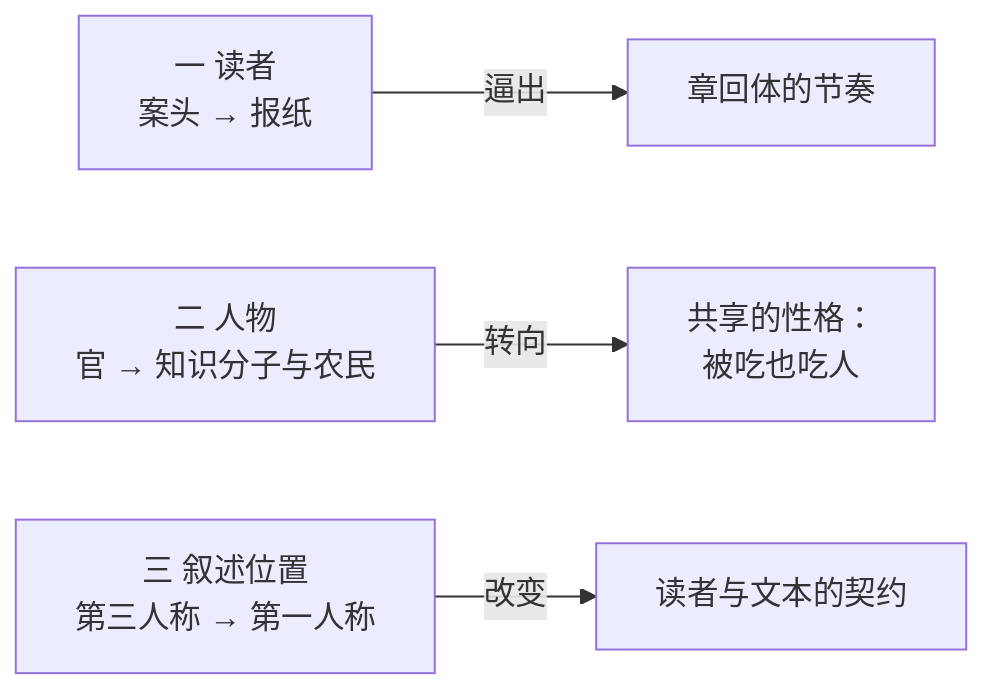

# ch000 三次转折

> 底本：示例材料 `demo.txt`｜本章 11 段 / 709 字
> 标注：`〔引〕`原文逐字｜`【原意】`｜`【事实】`｜`【推断】`｜`【存疑】`

## 一句话

起点不是中立的：作者把"从哪里读起"当成一个会分配重要性的动作，据此把现代小说的三次转折重排为读者、人物、叙述位置。

## 一段话

常见的文学史从一九一八年读起，白话因此成为分水岭。作者换成一九〇二年读起，白话随即降为一个技术选项，晚清小说家早已用浅近文言写时事、用连载养读者 (p003)。据此他重排三次转折：第一次在读者，小说从案头移到报纸，作者写作时想的是"明天还有没有人买这份报"，逼出章回体的节奏 (p006)；第二次在人物，中心从官转向知识分子与农民，转向他们共享的那套性格 (p007)；第三次在叙述位置，第一人称把"我"变成一个有限的人，读者要替叙述者打折扣读 (p008)。最后他留了一个自己没答的问题：若第一次转折更根本，以人物形象为纲写文学史是否把结果当成了原因 (p010)。

## 正文

### 一 起点决定视野

作者的第一个动作不是给结论，是换起点。〔引〕"起点不是中立的，它预先分配了谁重要。" (p003) 这句话是全篇的方法前提：同一段文学史，从一九一八年切和从一九〇二年切，会得到两套完全不同的重要人物名单。前一种切法让白话成为分水岭，后一种切法让白话退成一个技术选项——因为晚清小说家已经在用浅近文言写时事，也已经懂得用连载让读者等下一期 (p003)。

【推断】这一步的结构与"换一个起点，中心人物就换一批"是同一种操作，只是这里换的是年份，那里换的是人物。原文没有明说这层类比。

### 二 三次转折

三次转折被逐个点清，是一个封闭清单，数目为三。

第一次在读者。小说从士大夫的案头移到报纸版面，读者变成一个不具名的群体；作者写作时想的不是某位朋友，而是〔引〕"明天还有没有人买这份报" (p006)。他的判断是这一转"逼出了章回体的节奏"——形式不是文人趣味的结果，是发行方式的结果。

第二次在人物。晚清小说的配置是官坏、民苦、中间需要一个"士"来看、来说；一九一八年以后官消失二三十年，焦点转向知识分子与农民，转向〔引〕"他们共享的那套性格——既是被人吃的，也是吃人的" (p007)。作者补了一句很关键的自我限制：〔引〕"这是一个很少被统计的现象，我在通读近百部作品之后才注意到。" (p007) 【原意】他把这当作观察而非论证，措辞是"注意到"，不是"证明了"。

第三次在叙述位置。第一人称的大量出现不只是技巧更新，它把"我"变成一个有限的人：不知道别人的心思，判断可能是错的，读者因此第一次要替叙述者打折扣读 (p008)。作者的定性是这一转〔引〕"最不显眼，但它改的是读者与文本的契约" (p008)。

### 三 作者留下的问号

结尾没有收拢，反而把前面的排序拆了一道缝：如果第一次转折（读者）比第二次（人物）更根本，那么以人物形象为纲写文学史，是不是把结果当成了原因 (p010)。作者自陈〔引〕"这个问题我没有答案，只能把它留在结尾。" (p010)

【原意】这个自陈值得单独标出：它把前面三次转折的排序从"结论"降为"一种排法"，读者因此知道该往哪里接着想。

## 关键引文

- 〔引〕"起点不是中立的，它预先分配了谁重要。" (p003) —— 全篇的方法前提。
- 〔引〕"明天还有没有人买这份报" (p006) —— 把形式变化归因于发行方式的那一句。
- 〔引〕"他们共享的那套性格——既是被人吃的，也是吃人的" (p007) —— 第二次转折的落点。
- 〔引〕"最不显眼，但它改的是读者与文本的契约" (p008) —— 第三次转折的分量所在。

## 术语

| 术语 | 界定 | 出处 |
|---|---|---|
| 章回体 | 分回标目、以"话说""且听下回分解"衔接的长篇体式 | 原文 (p006) |
| 第一人称限知 | 叙述者只知自己所感所想、不进入他人内心的叙述方式 | 作者未用此名，此处按学界通名概括 (p008) |

## 缺口

- 原文称"晚清的小说家早就在用浅近的文言写时事"，未举具体作品与年份 (p003)。
- 第二次转折"官消失二三十年"未给统计口径：按哪些作品、哪些年份计，原文未提供 (p007)。
- 三次转折的排序依据未明说，只说"我因此把三次转折重新排了顺序" (p004)。
