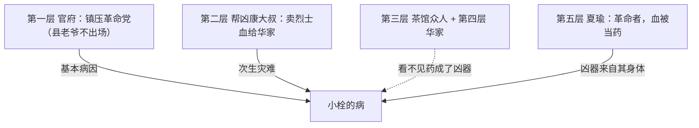

# 可视化规则（易）

图的目的是让关系一眼看见，不是让页面好看。判断标准只有一条：**删掉这张图，读者会不会真的读不懂**。会，就画；不会，就不画。

## 什么时候画

| 材料里出现的东西 | 画什么 | mermaid 类型 |
|---|---|---|
| 分层递进（三层定义、五个阶层、四个阶段） | 层级图，标出每层判别标准 | `flowchart TD` |
| 因果链（A 导致 B，B 又回过头加重 A） | 流程图，箭头写动作不写编号 | `flowchart LR` |
| 转化条件（什么条件下从甲变成乙） | 状态图，条件写在箭头上 | `stateDiagram-v2` |
| 多个文本/立场对同一命题的处理 | 并列对照，同一维度对齐 | 表格优先于图 |
| 时间先后、版本更迭 | 时间线 | `timeline` 或 `flowchart LR` |
| 概念从属（谁的上级概念是什么） | 思维导图 | `mindmap` |

## 什么时候不画

- 一句话能说清的（「全章分三节」不需要图）。
- 纯装饰：封面图、章节配图、为每节配一张「结构图」。
- 和前文重复：正文已经列过的清单，不必再画一遍。
- 关系本身是推测：原文没说 A 导致 B，就不能画这根箭头。缺证据不是连线的许可。

## 四条硬约束（取自 learn-from-materials 图表规范）

1. **编号不单独出现**。节点必须带名称与类型，编号只能附在旁边。不许出现只写着「①」「②」的节点。
2. **关系文字写出两端**。写「官场官员消失 → 焦点转向国民性」，不写「①→②」。边的标签要能脱离图独立读懂。
3. **不只靠颜色编码关系**。颜色可以辅助，但关系的性质（支持、反驳、导致、对比）必须写出来。
4. **图上措辞与正文同一份**。同一个概念在图里和正文里用同一个词，不另造简称。

## 写法要点

- 节点文字用中文时，含括号、顿号、箭头的标签要加引号：`A["五阶层（含帮凶）"]`。
- 一张图不超过 12 个节点；超了就拆成两张，或用表。
- 图放在需要它的那一段之后，不放章首当装饰。
- 每张图下面不写「如图所示」这类话——图自己能读，正文接着说结论。

## 验收

```
python scripts/gate.py ...
```
门禁的 YI4 会检查 mermaid 里有没有「`-->|1|`」这种纯编号标签。有就判不合格。

## 一个例子

《药》的五阶层，画图比列清单多出来的信息是**谁看不见谁**：



四层箭头方向不同，虚线表示认知盲区，这才值得画。如果只是把五个名字并排，用列表就够了。
